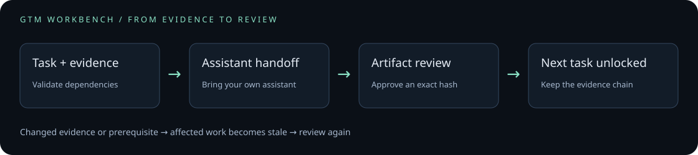
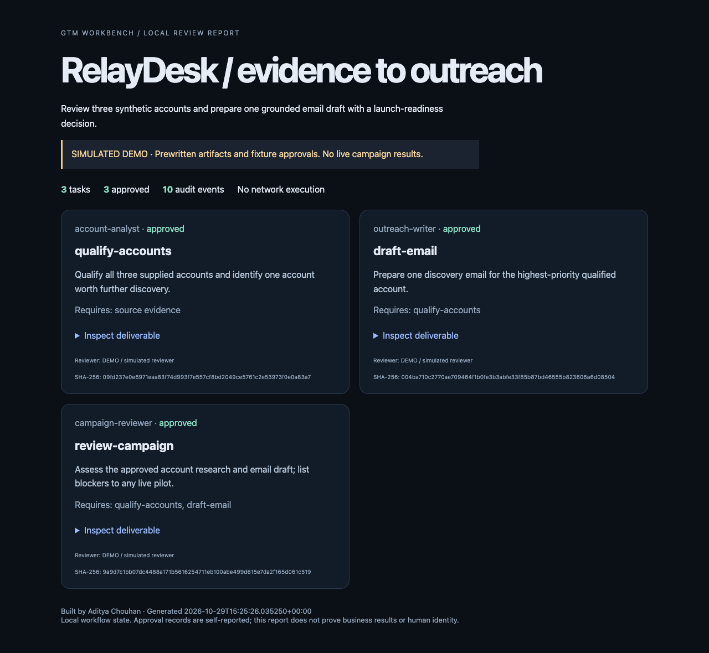

# GTM Workbench

**An evidence-grounded workflow ledger for GTM agent teams.**

Built by **Aditya Chouhan**. Python 3.9+ · MIT · zero runtime dependencies.

Turn a GTM goal into structured work, hand each task to your preferred AI assistant,
and review the resulting files before downstream tasks can use them. The ledger
remembers the exact artifact and evidence you approved. Changed inputs make old
approvals stale, including approvals farther down the dependency chain.

## Try it in one minute

```bash
git clone https://github.com/Aditya-chouhan/gtm-workbench.git
cd gtm-workbench
python3 examples/demo.py --output demo-output
python3 -m gtm_workbench -w demo-output status
```

The clone URL above is the intended publication location; until this repository
is published, download/copy the source and run the final two commands from its root.
Open `demo-output/report.html` in a browser. It contains three inspectable fixture
deliverables: account qualification, an email draft, and a readiness review.
The demo uses **synthetic data, prewritten artifacts and simulated approvals**.
It makes no model calls, spends nothing and sends nothing.





The [included demo report](docs/demo.html) is a standalone HTML file you can open
locally. It labels fixture approvals explicitly and lets you inspect each artifact.

## What works today

| Capability | Implemented behavior |
|---|---|
| Team contracts | Nine role definitions; task-specific outcomes, acceptance criteria and limits |
| Task graph | Validate dependencies and reject cycles, duplicates and unknown roles |
| Durable state | Transactional SQLite ledger; reopen a workflow across sessions |
| Handoffs | Generate a prompt containing the task, source files and approved upstream artifacts |
| Review | Snapshot UTF-8 deliverables; require an exact artifact hash when recording approval |
| Freshness | Recompute evidence/dependency hashes; block stale work and propagate invalidation |
| Recovery | Record a failed task and explicitly restart it; preserve chronological audit events |
| Inspection | JSON status/events and a portable HTML report; report text is HTML-escaped |

This is a **local coordination tool**, with an assistant-facing skill and manual
model handoff. It does not start autonomous agents, authenticate a reviewer,
enforce OS permissions, connect CRM accounts, enrich leads, publish or send.
Human review still determines whether a claim is supported; citing a file does
not mechanically prove the claim is true. Local database access is trusted.

## Use your own campaign

Create a workspace with your company evidence and a JSON plan. The example is a
complete starting point:

```bash
mkdir my-campaign
cp examples/company.md my-campaign/company.md
python3 -m gtm_workbench validate examples/outbound-plan.json
python3 -m gtm_workbench -w my-campaign init examples/outbound-plan.json
python3 -m gtm_workbench -w my-campaign start qualify-accounts
python3 -m gtm_workbench -w my-campaign handoff qualify-accounts > handoff.md
```

Give `handoff.md` to your assistant, using the role guidance from `agents/` as
needed. Save its result as `qualification.md`. Inspect it, then submit:

```bash
python3 -m gtm_workbench -w my-campaign submit qualify-accounts qualification.md --cite company.md
python3 -m gtm_workbench -w my-campaign artifact qualify-accounts
python3 -m gtm_workbench -w my-campaign status
python3 -m gtm_workbench -w my-campaign review qualify-accounts approve \
  --reviewer "Your name" --note "Checked all account facts against supplied evidence" \
  --sha COPY_THE_FULL_ARTIFACT_SHA256_FROM_STATUS
```

The hash argument is deliberately explicit: approve the artifact you inspected.
It is a local review record, not a credential or authorization for a live send.
The next task becomes ready only after current upstream approval.

```bash
python3 -m gtm_workbench -w my-campaign review qualify-accounts revise \
  --reviewer "Your name" --note "Need a source for the hiring claim"
python3 -m gtm_workbench -w my-campaign events
python3 -m gtm_workbench -w my-campaign report review.html
```

Plans are immutable after initialization. For a different task graph, initialize
a new workspace. Source evidence remains editable; restart affected tasks when
it changes. Relative evidence paths are resolved inside the workspace, including
symlink resolution. Deliverables are stored as snapshots in the ledger.

Additional plans in `examples/` cover content preparation, conversation triage
and experiment readouts. Copy each plan's declared evidence files into its workspace
before starting. All included business data is fictional.

## The team

| Role | Deliverable |
|---|---|
| Coordinator | Task graph, owner, constraints and review checkpoints |
| Researcher | Dated facts, source references and unresolved questions |
| Account Analyst | ICP qualification with reasons and unknowns |
| Outreach Writer | Evidence-grounded first touches and follow-ups |
| Campaign Reviewer | Audience/copy/readiness findings and launch blockers |
| Conversation Analyst | Reply intent, deal context and a proposed next response |
| Content Editor | Editorial briefs tied to audience questions and available proof |
| Content Producer | Platform-specific drafts and editable design briefs |
| Experiment Analyst | Observations, measurement limits and a scale/revise/stop recommendation |

Roles are instructions you can use in your assistant, not background processes.
See [agent contracts](agents/README.md), the [workflow format](docs/workflows.md),
and [architecture and trust boundaries](docs/architecture.md).

## Assistant skill

The self-contained `skills/gtm-team/` folder can be copied into your assistant's
supported skills directory. It teaches task planning, evidence handling and review
handoffs. CLI use requires this repository on the machine; installing Markdown
does not install the CLI. `python3 -m gtm_workbench` works from this repo without
installation. For a console command, optionally run `python3 -m pip install .`.

## Verify

```bash
python3 -m unittest discover -s tests -v
python3 examples/demo.py --output demo-output
```

The tests exercise dependency blocking, stale approval propagation, source
changes during work, artifact snapshots, review hashes, retries, path traversal,
symlink escapes, HTML escaping and CLI failures. CI is configured for Python
3.9, 3.12 and 3.13; only a completed CI run verifies those hosted environments.

## Design background

Inspired by Tim Scheuer's MIT-licensed
[Grok Bot GTM team](https://github.com/timscheuerai/grokbot-gtm-team).
Its role separation and review-first approach motivated this project. Workbench
adds executable local workflow mechanics with original code and role contracts.
See the [reference review](docs/reference-review.md) for the inspected revision,
full file coverage, strengths, limitations and the comparison scope. This project
does not claim better campaign results or a replacement for hosted integrations.
Attribution and the upstream license are in [THIRD_PARTY_NOTICES.md](THIRD_PARTY_NOTICES.md).
