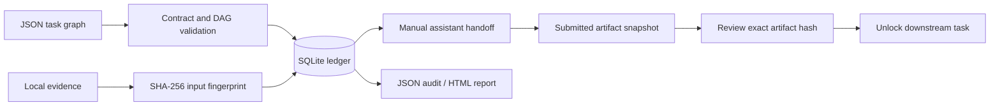

# Architecture and trust boundaries

## Data and state

The only runtime dependency is Python's standard library. Each workspace has a
SQLite database at `.workbench/ledger.sqlite3` with immutable task specifications,
artifact bytes, evidence citations, context fingerprints, approval records and
chronological events. Mutations acquire a SQLite immediate transaction. A second
initialization refuses to overwrite state. There is no scheduler or network client.

Stored states are `pending`, `working`, `review`, `approved`, and `failed`.
Effective status is computed as `ready`/`blocked` for pending work, and `stale`
for started work whose source/dependency context has changed. Approvals bind the
artifact hash, the task/evidence/dependency context hash, and submitted citations.
Changing a source, revising a prerequisite, or approving a changed prerequisite
invalidates downstream work recursively. An identical artifact reapproved against
identical context produces the same fingerprint and may restore validity.

A restart captures current inputs and clears the prior submission from the active
task row. Prior hashes and decisions remain in the event log; historical artifact
bodies are not versioned. Export an artifact before restarting if you need its text.
Plans are immutable in v0.1; changing the graph requires a new workspace.

## Guarantees and limits

- Evidence paths must resolve to files inside the workspace, outside its internal
  ledger directory. Symlinks that escape the workspace are rejected.
- A submission is copied into SQLite; editing its original file does not alter
  what was approved. Source changes do affect validity because sources are live.
- Approving a stale task or a hash other than the submitted artifact's is rejected.
- Dependency state gates local handoff/start/submit/review. It cannot control a
  separate assistant, browser, external platform or someone editing SQLite.
- Reviewer names and notes are self-reported. The ledger is an operational log,
  not a tamper-proof compliance record, identity system or multi-tenant service.
- Source contents are untrusted data. Delimiters and role instructions help the
  assistant handle them, but are not a prompt-injection security boundary.
- Citations are checked against declared inputs; semantic truth, dates and
  freshness windows need human judgment. Hashes detect changes, not age.
- Handoffs inline whole text files and upstream artifacts. Use small curated input
  bundles that fit the target assistant's context; there is no automatic truncation.
- Workspace files can be edited outside SQLite transactions. For reproducible work,
  keep evidence stable during a review operation. There is no filesystem snapshot
  or protection from a hostile local writer racing a check.

## Integration direction

The current integration point is a UTF-8 prompt out and a UTF-8 artifact in.
Any assistant can operate this interface manually. A future provider adapter would
need bounded costs, credential storage, timeouts, output validation and verified
execution receipts before it could claim live execution. None is implemented here.
